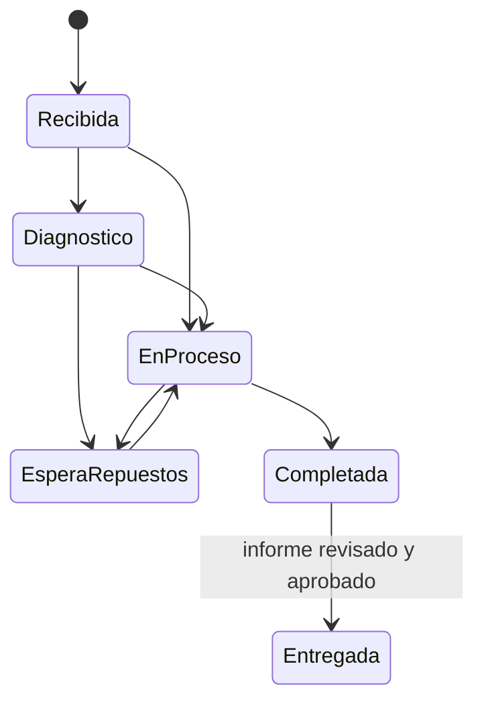
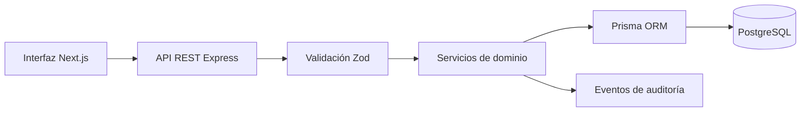
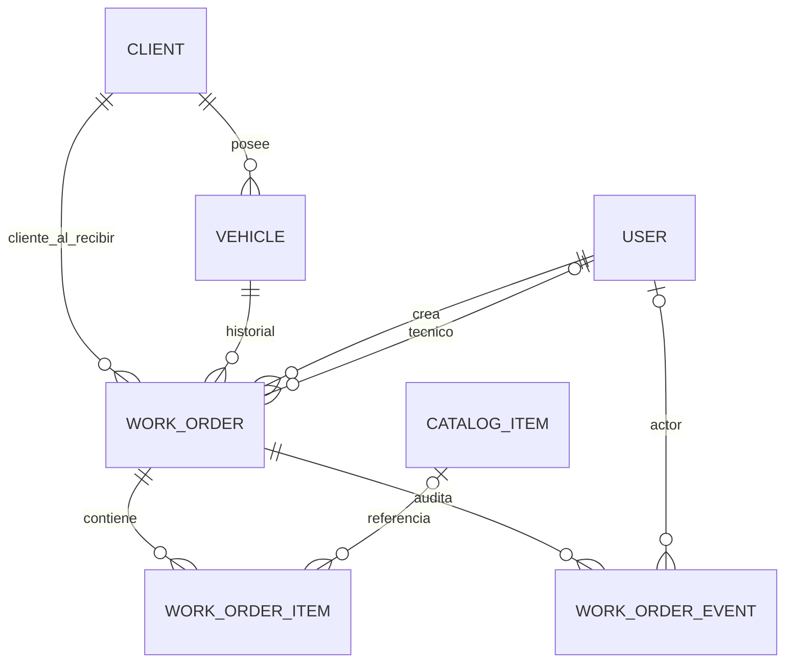

# Arquitectura y primera versión funcional — TallerSmart

**Estado:** versión de alcance para Proyecto I. La aplicación disponible es una demostración web; la persistencia PostgreSQL y la API son la arquitectura objetivo y aún requieren integración.

## Objetivo de la primera versión

Completar y demostrar una orden de trabajo de principio a fin: recepción de un vehículo existente, registro del motivo de ingreso, consulta y edición de la orden, avance por estados permitidos, preparación de un informe basado únicamente en los datos de la orden, aprobación humana y entrega. El sistema organiza y conserva información; no reemplaza el diagnóstico del mecánico.

Quedan fuera del MVP: inventario, recordatorios automáticos, múltiples sucursales, analítica de negocio, recomendaciones de mantenimiento y diagnóstico mediante IA. La clasificación por palabras clave, los intervalos fijos y el informe por plantilla son reglas deterministas; no se presentan como aprendizaje automático ni como generación con modelo.

## Flujo principal y estados

Reglas para la demostración:

- Una orden se crea con vehículo, cliente asociado en la recepción, kilometraje de entrada y motivo de ingreso. El motivo no puede estar vacío.
- Cada cambio de estado se agrega al historial de la orden con fecha, estado anterior, estado nuevo y rol activo.
- Solo se permiten las transiciones dibujadas. La transición a **Entregada** requiere un informe editable cuya versión aprobada coincida con la versión que se entrega.
- El informe se compone de campos existentes de la orden (motivo, diagnóstico, trabajos, repuestos y total). No agrega recomendaciones ni datos no registrados. El asesor revisa y aprueba antes de entregar.
- Los cambios de propietario actualizan el vínculo del vehículo; cada orden conserva el cliente asociado al momento de recepción. Una corrección de kilometraje requiere registrar valor anterior, nuevo valor, actor y motivo en el historial.
- Todo trabajo o repuesto adicional debe quedar pendiente de autorización del cliente antes de ejecutarse. Un cambio de precio debe guardar valor anterior/nuevo y motivo, y actualizar el total desde los ítems; nunca se sobrescribe silenciosamente.

## Arquitectura

En la demostración actual, la interfaz Next.js conserva las órdenes en `localStorage` del navegador para que el flujo sobreviva a una recarga. Los registros de ejemplo y las nuevas órdenes solo existen en ese navegador. Esto es persistencia de demostración, no almacenamiento compartido ni respaldo. El backend Express está en etapa de esqueleto; el esquema Prisma describe el modelo objetivo, pero todavía no está conectado a la interfaz ni tiene migración aplicada.

## Modelo de datos consolidado

El esquema ejecutable se mantiene en `apps/api/prisma/schema.prisma`.

| Entidad | Responsabilidad |
| --- | --- |
| `Client` | Datos de contacto del propietario/cliente. |
| `Vehicle` | Identidad del vehículo, propietario actual y kilometraje reportado. |
| `User` | Cuenta y rol: administración, asesoría o técnico. |
| `WorkOrder` | Fotografía de cliente y vehículo al ingreso, estado, motivo, diagnóstico, kilometrajes, total e informe. |
| `WorkOrderItem` | Servicio o repuesto con nombre/precio capturados, cantidad y estado de autorización. |
| `CatalogItem` | Referencia opcional de precio y descripción; la orden conserva su propia fotografía de nombre y precio. |
| `WorkOrderEvent` | Registro cronológico de creación, cambios de estado, autorizaciones, correcciones y aprobaciones. |

## Roles, permisos y auditoría

| Acción | Asesor | Técnico | Administrador |
| --- | --- | --- | --- |
| Crear recepción / OT | Sí | No | Sí |
| Registrar diagnóstico y trabajo ejecutado | No | Sí | Sí |
| Proponer trabajos o repuestos adicionales | Sí | Sí | Sí |
| Registrar autorización del cliente | Sí | No | Sí |
| Cambiar costos del catálogo | No | No | Sí |
| Aprobar informe y entregar OT | Sí | No | Sí |

Cada evento auditable guarda actor, fecha/hora, acción, valor anterior y valor nuevo. La demostración en navegador conserva el historial junto a cada orden; el backend deberá escribir eventos en `WorkOrderEvent` dentro de la misma transacción que modifica la orden.

## Validación y criterios de aceptación

La validación se hará con un taller participante antes de afirmar mejoras. No se ha registrado todavía un taller ni una línea base, así que las metas numéricas siguientes son **propuestas por confirmar** con ese taller:

1. Completar 5 recepciones de prueba seguidas sin perder cliente/vehículo, kilometraje ni motivo al recargar la aplicación.
2. Ninguna transición fuera de la máquina de estados está disponible; el paso a Entregada permanece bloqueado sin aprobación del informe vigente.
3. El 100% de las operaciones de creación, cambio de estado y aprobación se ve en el historial con actor y hora.
4. Comparar tiempo de recepción manual actual frente al flujo digital en al menos 10 órdenes observadas; reportar mediana y rango, sin afirmar reducción hasta medirla.
5. Revisar informe de al menos 10 órdenes con el asesor: cada nombre de trabajo/repuesto, diagnóstico y valor debe tener correspondencia con un dato de la orden; tolerancia cero para elementos inventados.

## Deuda explícita para la siguiente iteración

- Implementar rutas de órdenes y clientes, autenticación y autorización real en Express.
- Aplicar una migración de Prisma y conectar la interfaz a PostgreSQL; dejar `localStorage` solo como modo demostración/offline.
- Validar el esquema Prisma y automatizar la política de transiciones en el servicio (no confiar solo en ocultar botones de interfaz).
- Reemplazar los datos de ejemplo por datos autorizados del taller participante y documentar consentimiento, anonimización y línea base.
- Si se incorpora un modelo generativo, medirlo por separado contra una plantilla determinista, usar solo datos de la OT como fuente permitida y exigir aprobación humana antes de publicar.